<p align="center">
  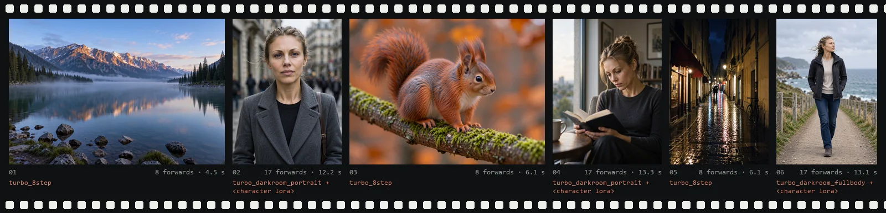
</p>

# MossPhoton

**MOSS-Image in ComfyUI you can check: a sampler bit-for-bit equal to the native graph on its `reference` preset, an 8-step turbo, LoRA phases, a second pass that can hold the face, and a report of every sampler run.**

ComfyUI-MossPhoton is twelve nodes for text-to-image with MOSS-Image SFT. The `reference` preset is bit-for-bit equal to the native graph on the 10 cases measured, so every other preset and control is a step you can compare against. Same prompt and seed, different pictures: `turbo_8step` costs 8 forwards and about 5 s here, `reference` 100 forwards and about 45 s, warm, on one RTX 5090 ([frames](#presets)); nothing is known about turbo quality.

`12 nodes` · `12 presets` · `8 vs 100 forwards` · `2,188 tests, 0 skipped` · `10 bit-exact cases + 3 turbo corner cases` · `MIT`

[Quick start](#quick-start) · [The pack](#the-pack) · [Bit-for-bit](#bit-for-bit-then-everything-else) · [Darkroom](#how-the-darkroom-samples) · [Presets](#presets) · [Controls](#what-each-control-moves) · [Finishing](#finishing) · [Lab notes](#lab-notes) · [Reference](#reference) · [Usage](docs/USAGE.md)

<sub>All frames: MOSS-Image SFT with the official text encoder, one RTX 5090. First-pass frames are about 1.5 to 1.6 MP, Hires Fix frames about 3.6 MP. The only person shown is one fictional character, rendered with a `<character lora>`; the one style LoRA is a `<style lora>`. Seconds are warm whole-graph runs except where a caption says otherwise, and compare only inside one panel set. Most controls have one frame on one seed. Version 0.4.0.</sub>

> [!NOTE]
> **SFT only. Base: not verified in v1.** Calibration stages B to D are not done. Only `reference` is `stable`; the turbo and darkroom presets are `candidate` or `experimental`, and they carry the distill LoRA card's recipe or the maintainers' own darkroom recipe. The pack makes no claim of a gain in quality, identity or realism. Tested only on ComfyUI 0.42.0 (commit `8f04fd6ec`), frontend 1.55.18, Python 3.13, one machine. Full table: [docs/STATUS.md](docs/STATUS.md).

| Verified | Not verified |
|---|---|
| `reference` is bit-for-bit equal to the native graph: 10 cases, ComfyUI 0.42.0, one RTX 5090 (earlier commit, recorded encoder: see the [limits](#bit-for-bit-then-everything-else)) | Base checkpoints; any other GPU or ComfyUI build |
| Turbo presets equal the native turbo graph: 10 cases and 3 corner cases | Turbo quality on SFT: the quality sheets were not run, and the distill LoRA was trained on Base |
| Determinism (10 cases × 3 runs) and 30 stability jobs | Calibration stages B to D; the darkroom presets (only `w_commit` was calibrated) |
| 8 forwards against 100 (measured). One timed run per frame, same prompt and seed, different pictures: turbo 4.5 to 6.1 s, reference 44 to 48 s | Any gain in quality, identity or realism: no claim |
| 2,188 tests, 0 skipped; a report on every sampler run | Hires Fix defaults (2 seeds, one prompt); Identity Detailer (one smoke, 3 seeds) |

<p align="center">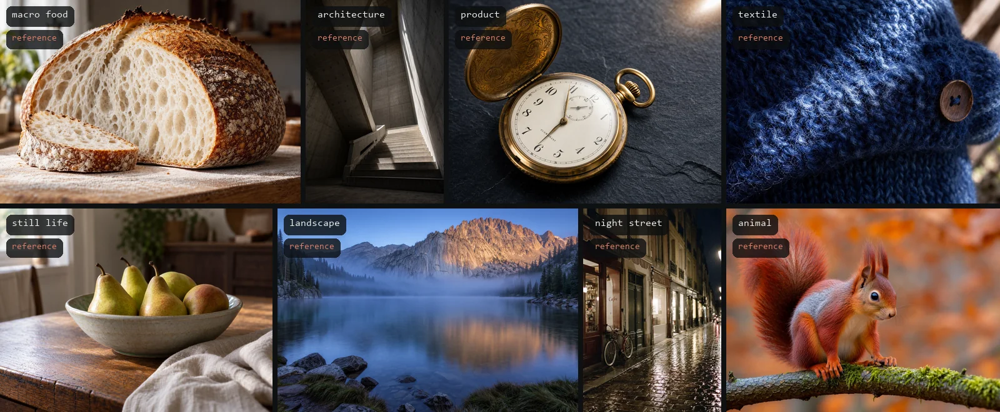</p>

Same recipe for all eight: preset `reference` (50 steps, 100 forwards), seed 7001, no LoRA. Each took 44 to 48 s.

---

## Quick start

1. Install, no extra pip packages:
   ```sh
   cd ComfyUI/custom_nodes
   git clone https://github.com/Kostik2702/ComfyUI-MossPhoton
   ```
   A junction or a copy works too: [docs/INSTALL.md](docs/INSTALL.md). Restart ComfyUI.
2. Drag `workflows/sft_reference.json` onto the canvas. Download the weights named in its Note (and in [INSTALL, section 3](docs/INSTALL.md)) or pick your own in the loaders. The LoRA workflows use placeholder names you replace.
3. Read [docs/USAGE.md](docs/USAGE.md): the nodes one by one, the rule "cfg 0 = take the preset's value", `preset_pin`, the effective-settings panel and the turbo workflow.

Six example workflows ship in `workflows/`: `sft_reference`, `character_lora`, `multi_lora`, `turbo_8step`, `turbo_identity` and `turbo_darkroom_portrait`. Each carries a Note with weights and preset status.

## The pack

The Sampler takes a seed, a preset and an optional `cfg`, and computes the rest. The Advanced sampler exposes the same loop with more knobs, including the darkroom phase controls. The other nodes prepare the run, finish the image or record what happened.

| Node | Stage | What it does |
|---|---|---|
| **Moss Photon Sampler** | sampling | Preset, seed, `cfg` (0 = the preset's). Bit-equal to the native graph on `reference` (10 measured cases). Returns a latent and a report. |
| **Sampler (Advanced)** | sampling | Experimental. The same loop with `sigmas`, SLG, `steps` and the darkroom knobs (`r_c`, `r_k`, `r_f`, `w_compose`, `w_commit`, `finish_cfg`, `eta`, `reexpose`, `switch_model`). |
| **Schedule** | sampling | The sigma schedule. Mode `reference` equals the native one bit for bit. Feeds the Advanced sampler only. |
| **Empty Latent** | setup | The 128-channel latent. A size that is not a multiple of 16 is refused, not floored. |
| **Prompt & Layout** | setup | Your positive text comes first and is never altered. The blocks `identity`, `wardrobe`, `scene`, `pose`, `camera` and `lighting` follow as labelled lines; `forbidden_changes` stays out of the prompt; `layout_json` is experimental. |
| **Prompt Split** | setup | Helper: turns the marker-delimited answer of a prompt enhancer into the fields of Prompt & Layout. |
| **LoRA Phase** | setup | Puts one LoRA on one phase of the run: `all`, `composition`, `identity`, `texture` or `composition+identity`. Ordinary LoRA loaders work as they are. |
| **LoRA Profile (deprecated)** | setup | The older per-adapter node. Kept so old graphs keep working; the Identity Detailer still needs its `identity_profile`. |
| **Diagnostics** | diagnostics | Measures the image (luma, clipping, sharpness, non-finite pixels) and applies no threshold. |
| **Save Image** | output | PNG, JPEG or WebP, never overwrites, writes the report as a PNG chunk or a sidecar. |
| **Hires Fix** | finishing | Experimental. Upscales the latent and redraws it in a short second pass. With the optional face detector, faces are held at the source until sigma 0.35; without it the pass is unprotected. |
| **Identity Detailer** | finishing | Experimental. Redraws small faces and keeps the result only if a check passes. Needs optional packages. |


A setting that conflicts with another does not stop the run. The node moves to the nearest value it can run and writes a warning in the report (`setting_adjusted`, `override_outside_bounds`, `forward_budget_exceeded`, `preset_pin_mismatch`, ...). A node stops only for what is impossible: a missing file, a wrong model, latent or VAE, a LoRA that cannot be mapped, a non-finite output ([USAGE, section 1](docs/USAGE.md)).

## Bit-for-bit, then everything else

<p align="center">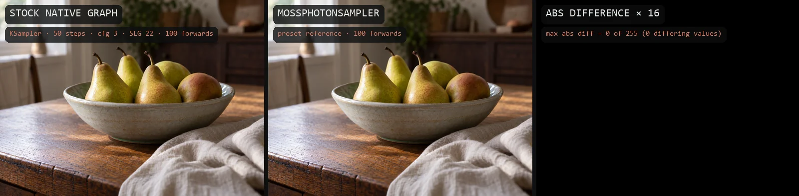</p>

Left: the stock graph (`CLIPTextEncode`, SLG on layer 22, `KSampler` euler `sgm_uniform`, 50 steps, cfg 3, 100 forwards). Middle: `MossPhotonSampler`, preset `reference`, the same seed and prompt. Right: their difference. Over the whole 1456 × 1088 RGB image the largest difference is 0 of 255, with 0 differing values.

That is the foundation. When a frame further down differs from this one, the setting you moved is the reason: the sampler adds no hidden step, and its report lists the forwards, the warnings and the plan LoRAs by name (patches from ordinary loaders are counted, not named).

| Check | Preset | Result |
|---|---|---|
| Parity with the native graph | `reference` | Bit-exact on 10 fixed cases: equal latents and images, equal sigma arrays and forward counts, F = 0 |
| Parity of the turbo presets | `turbo_8step`, `turbo_identity` | Bit-exact against the native turbo graph on 10 cases plus 3 corner cases (16 steps at CFG 2, 12 steps at CFG 1.5) |
| Determinism | `reference`; turbo | 10 cases × 3 repeats give identical latents; turbo 12 cases × 3 |
| Stability | `reference`; turbo | 30 jobs with interleaved LoRA stacks and sizes, no failed job. Device memory after unload grew 0.00 % (`reference`) and 2.63 % (turbo), limit 5 %: a residual from the Windows per-process counter, not a peak |
| Release tree 0.4.0 | | Unit 1,521, integration 628, quality 39 tests, 0 skipped, on the unpacked release zip. GPU smoke on that tree, `reference` and turbo: cases C01 and C19 pass with difference 0, and the turbo negative control fails as it must |

Limits of the claim: the GPU gates ran at reduced sizes (30 jobs at 10 steps, not 100 at 50; [DEVIATIONS, B10](docs/DEVIATIONS.md)), on one machine, one GPU and one ComfyUI build. The 10-case gates ran on an earlier commit (`5b33c0e`) with a non-official text encoder file recorded by hash (DEVIATIONS, DV20), and the 0.4.0 C01 and C19 smoke used that same file; the pair in the image above is a separate run on the official encoder. Equality is not a statement about image quality, and parity has to be re-checked after a ComfyUI upgrade.

## How the darkroom samples

The darkroom presets cut one run into phases along the sigma axis, like steps in developing a print: compose the layout, commit the character, hold if you ask for it, finish the detail.

<picture>
  <source media="(prefers-color-scheme: dark)" srcset="docs/readme/phases-dark.svg">
  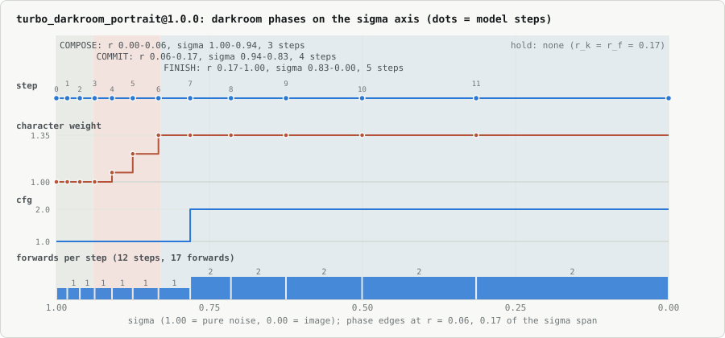
</picture>

`turbo_darkroom_portrait`: 12 steps on the 8-step distill stack, 17 forwards.

| Phase | Sigma progress r · steps | Sigma | Guidance | What happens |
|---|---|---|---|---|
| **Compose** | 0.00 → 0.06 · 3 | 1.00 → 0.94 | 1.0, one forward per step | Layout and framing are decided. |
| **Commit** | 0.06 → 0.17 · 4 | 0.94 → 0.83 | 1.0 | The character LoRA weight rises from 1.0 to 1.35 (`w_commit`) by a smoothstep: +0.35 is added to the strength of LoRA Phase entries with phase `identity`. A negative strength skips it, and only known distill files are recognised and skipped. |
| **Hold** | empty in this preset | | | `r_k` and `r_f` are both 0.17, so no step falls here. |
| **Finish** | 0.17 → 1.00 · 5 | 0.83 → 0.00 | 2.0 with the negative prompt, two forwards per step | The last steps, where the negative prompt acts. `eta` is 0 and `reexpose` is off in this preset. |

Seven single-forward steps plus five double ones make the 17 forwards. This is a candidate preset: experimental, uncalibrated, and outside the native graph, so its label is always `not_reference` (reason `darkroom_experimental`). Of its numbers only `w_commit` 1.35 comes from the maintainers' calibration.

## Presets

<p align="center">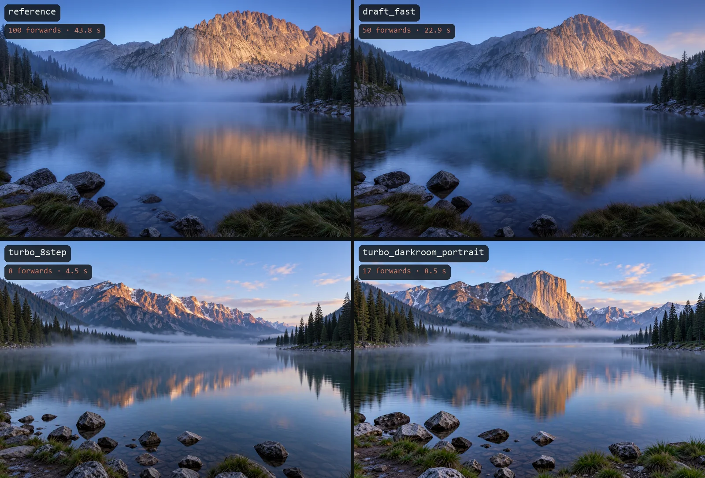</p>

Same prompt, same seed. The step count and the schedule shape the layout, so in this set the four renders are four different pictures: `reference` and `draft_fast` (50 and 25 steps) keep one composition, the two turbo presets another look. Turbo costs 8 or 17 forwards against 100: 4.5 s and 8.5 s against 43.8 s here.

<p align="center">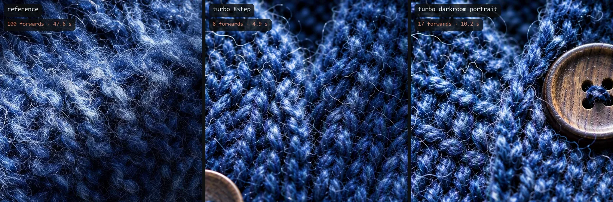</p>

Native crops, same prompt and seed. The three crops land on different parts of the knit, because the layouts differ per preset, so this shows how each preset renders surface and is not a like-for-like pixel comparison. <sub>Sampler · reference / turbo_8step / turbo_darkroom_portrait · native crop</sub>

The status of every preset and its numbers: [the table in Reference](#reference).

## What each control moves

Each demo changes one input and keeps the prompt, the seed and everything else fixed: one frame on one seed (7001) each.

### LoRA Phase on a character

<p align="center">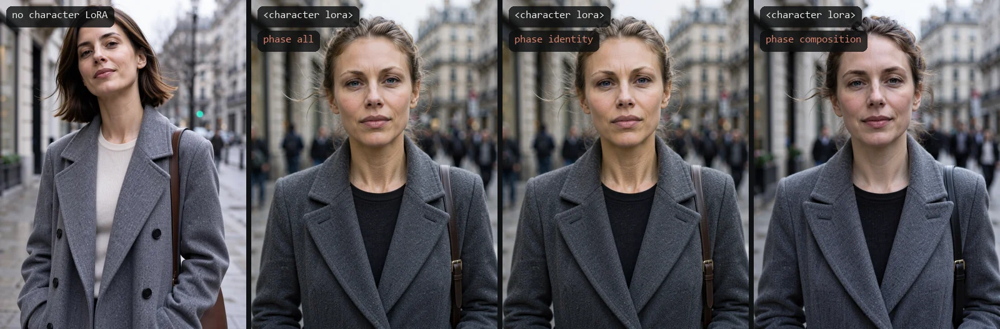</p>

LoRA Phase chooses when a LoRA acts. `all` is exactly an ordinary loader. `identity` is the node's default and acts from the first step on MOSS (a conservative choice, not a measured one); it differs from `all` only by the commit boost. Here the `w_commit` 1 frame equals the `all` frame pixel for pixel (max difference 0), and the preset's 1.35 moves it by a mean of 3.3 of 255. With `composition` the layout stays and the character's look moves visibly (mean difference to `all` 13.5 of 255). The frame without the LoRA is a different picture (51.1). One seed, no claim about which phase is best. <sub>LoRA Phase · `<character lora>` · none / all / identity / composition · turbo_darkroom_portrait</sub>

### Commit weight

<p align="center">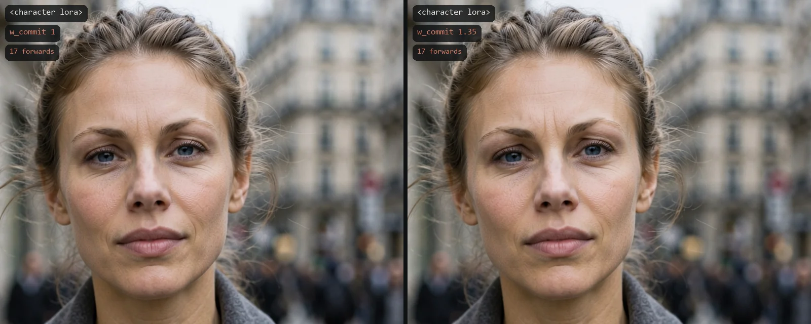</p>

`w_commit` is the character weight at the end of the commit window; the preset's value is 1.35. It is a small effect and the two crops here are close, one seed. The 1.35 comes from the maintainers' calibration of this preset (57 generations, 3 seeds, constant character profile, not the LoRA Phase shown): moving it from 1.2 to 1.35 was the only robust change, ArcFace similarity mean +0.022 [+0.012, +0.032] with the same sign in all three seeds and texture flat. Values above 1.35 were not tested, and other prompts and characters were not measured. <sub>Advanced · `w_commit` 1 / 1.35 · `<character lora>` on phase identity · native crop</sub>

### LoRA stack

<p align="center">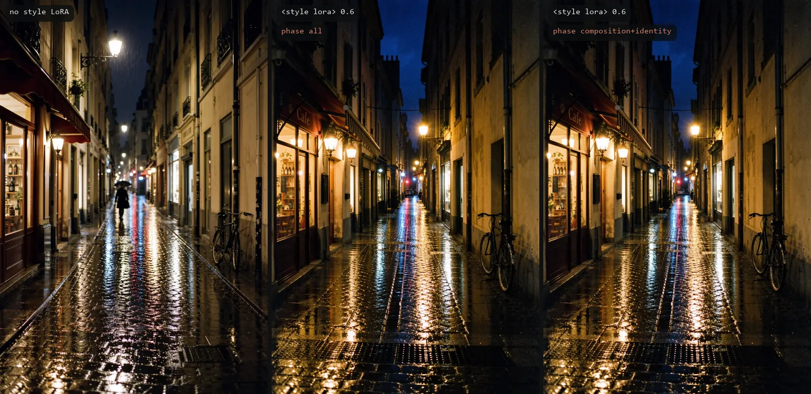</p>

Style and slider LoRAs are a starting point on `composition+identity`: they act in compose, commit and hold, are absent in the finish and never take the character boost. Here the style LoRA restyles the whole scene, and `all` and `composition+identity` come out nearly identical, so this frame does not separate them. The recommendation rests on a directional test (2 seeds, one full-body prompt): with the extras absent in the finish, mean ArcFace similarity moved .426 → .461, a control with the distill and the character only gave .467, the seed-42 gain (+.013) was inside the seed spread, saturation rose by 7.8 points, and the character ran on `all` in every arm, so the recommended stack itself was not measured ([USAGE, 3.3](docs/USAGE.md)). <sub>LoRA Phase · `<style lora>` 0.6 · none / all / composition+identity · turbo_darkroom_portrait</sub>

### Finish guidance

<p align="center">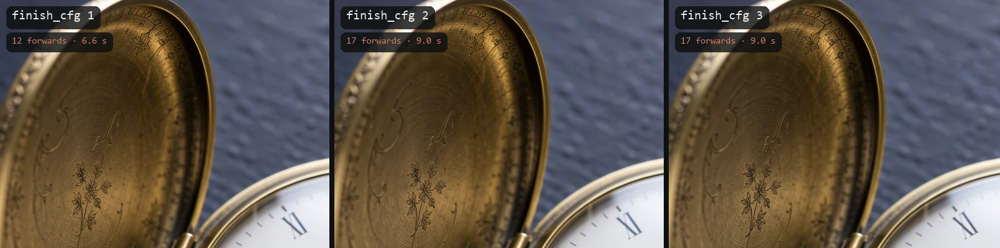</p>

`finish_cfg` is the guidance of the finish phase, the only phase where the negative prompt acts. At 1.0 the negative branch is dropped: one forward per step, 12 in all against 17. The three crops agree on structure and differ little; one seed, a small effect. <sub>Advanced · `finish_cfg` 1 / 2 / 3 · turbo_darkroom_portrait · native crop</sub>

### Finish noise

<p align="center">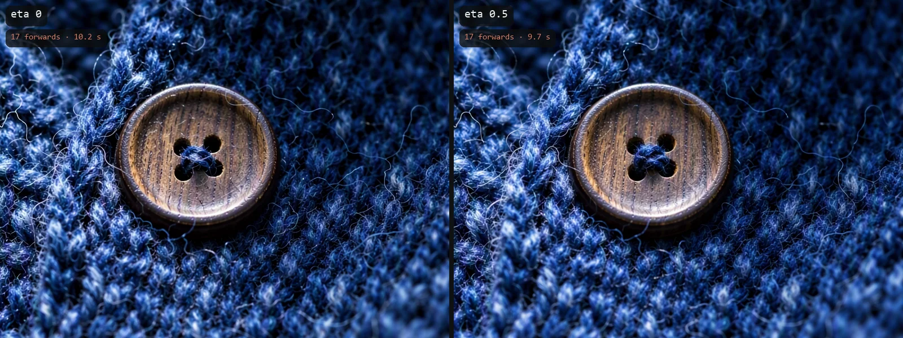</p>

`eta` injects noise during the finish phase; 0 is the preset and means off. The two crops share the composition; 0.5 changes fine texture and softens it, one seed (Laplacian variance of the full frame 870 against 670). <sub>Advanced · `eta` 0 / 0.5 · turbo_darkroom_portrait · native crop</sub>

### Steps

<p align="center">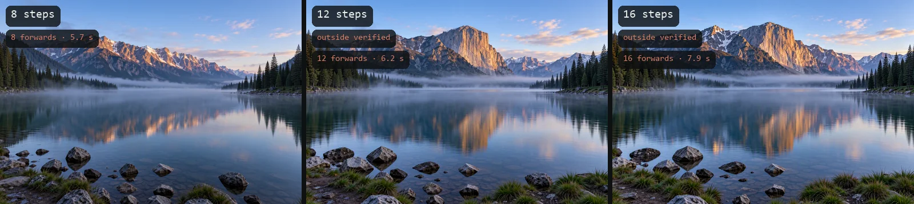</p>

Steps change the picture, not only the finish: the composition at 8 differs from the one at 12, and 12 and 16 resemble each other. Beyond 8 steps the report says `turbo_setting_outside_verified`, because the distill recipe is 8 steps. Forwards equal steps at cfg 1. <sub>Advanced · `steps` 8 / 12 / 16 · turbo_8step</sub>

## Finishing

### Hires Fix

<p align="center">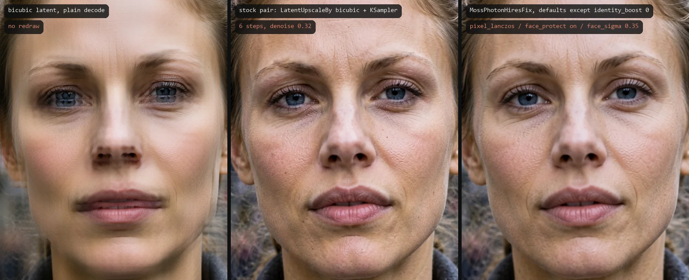</p>

The story is the left panel. A bicubic latent upscale decoded with no sampling leaves a semi-transparent second copy of the finest features, a doubled image. The stock graph hides it because it redraws everything from a high sigma, but a face held at the source would keep it. So the node's default upscale decodes, enlarges in pixels with Lanczos and encodes again (`pixel_lanczos`); `latent_bicubic` stays as the stock recipe and, with a face to hold, is replaced by `pixel_lanczos` with a warning.

Middle against right: both show a fine ripple, stronger in the stock pair (see Known limits). The node keeps the first-pass face, because detected faces are held at the source until sigma 0.35, and is smoother. Neither is claimed better; this is what each does. The second pass took 12.4 s (stock pair) and 12.3 s (node) with the 5.3 s first pass cached, about 17.6 s in all (a sum, not a run). The node frames are the defaults except `identity_boost` 0: its default is 0.2, it is added to the character LoRA's strength in this pass, and these frames do not show it. The defaults were measured on two seeds and one prompt. <sub>Hires Fix · scale 1.5, 6 steps, denoise 0.32 · `pixel_lanczos`, `face_protect` on, `face_sigma` 0.35, `identity_boost` 0 · first pass turbo_identity with a `<character lora>` · native crop</sub>

<p align="center">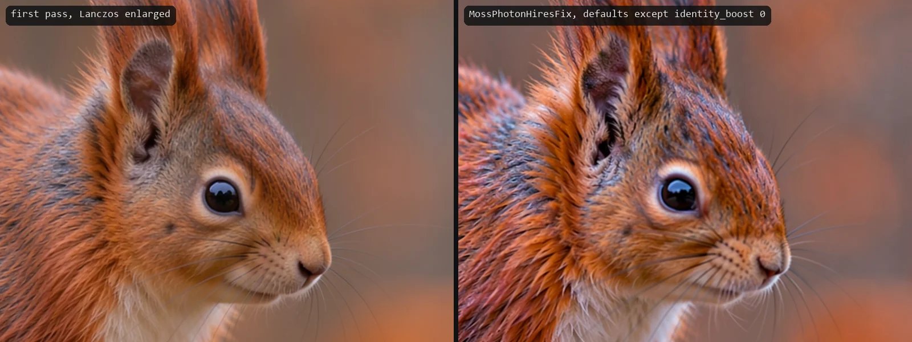</p>

On a scene with no person the node redraws the whole frame. Right against left: sharper, more contrasted fur, redrawn by the pass. The second pass took 10.6 s with the 5.9 s first pass cached, about 16.6 s in all (a sum, not a run). <sub>Hires Fix · defaults except `identity_boost` 0 · turbo_8step first pass, no character · native crop</sub>

Face protection needs the optional `ultralytics` package and a YOLO face model; without them the pass runs unprotected and says so (`hires_no_detector`). [USAGE, 3.9](docs/USAGE.md).

### Identity Detailer

<p align="center">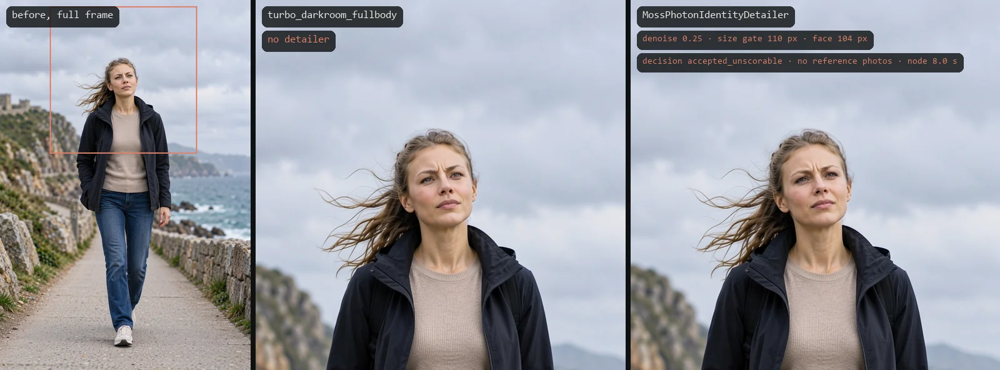</p>

In a full-body frame the face covers a small part of the latent. The detailer finds faces below a size gate (110 px short side), redraws the crop at 1024 px with the turbo stack of the MODEL, colour-matches it and pastes it back through a feathered ellipse; pixels outside the ellipse are bit-equal to the input. With reference photos and consent a redraw is kept only if an ArcFace check of the same face rises by at least 0.01, otherwise the original crop stays. By default, with no reference photos nothing is redrawn; this run set `accept_without_references` on, so the decision is `accepted_unscorable`: it is not scored. Of the three seeds tried in this set one was redrawn and two were skipped. <sub>Identity Detailer · denoise 0.25 · size gate 110 px, face 104 px · 8.0 s is the node's own time, the whole graph took 22.3 s · turbo_darkroom_fullbody · `<character lora>` through the LoRA Profile chain · native crop</sub>

The maintainers' GPU smoke, with reference photos: on 3 full-body seeds at 1 MP the ArcFace gate accepted one (0.467 to 0.509) and rolled back two, leaving 0 pixels changed. It is experimental. It needs `identity_profile` from the deprecated LoRA Profile chain with a distill adapter, and `ultralytics` plus a face model; `insightface` is needed for reference photos. [USAGE, 3.10](docs/USAGE.md).

## Lab notes

The docs say what failed as well as what shipped. Short versions from the [changelog](docs/CHANGELOG.md) and [deviations](docs/DEVIATIONS.md).

**Found: the bicubic latent upscale leaves a doubled image.** Visible in a plain decode of `LatentUpscaleBy` (first panel under Hires Fix); it decided the node's default. With `latent_bicubic`, `face_protect` off and `identity_boost` 0 the node is exactly the stock pair of nodes, bit for bit; a tiny-model test pins it.

<p align="center">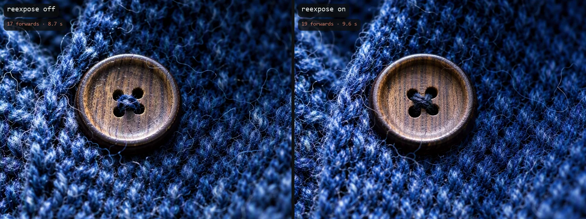</p>

**Rejected: re-expose.** The phase engine can re-noise the latent at the end of the commit window (`r_k`) and descend again (`reexpose`, `sigma_r`). It costs 2 more forwards (19 against 17) and visibly smooths the result (Laplacian variance of the full frame 870 against 687), so the presets keep it off. <sub>Advanced · `reexpose` off / on · turbo_darkroom_portrait · native crop</sub>

**Rejected: native LoRA weight hooks for a phased weight.** A hook applies the LoRA in float32 with stochastic rounding, while the dynamic-VRAM loader applies it in bf16: on three layers of the real checkpoint 1.5 % to 2.4 % of the bf16 weights differed, so a constant weight through hooks was not the stock result. The experimental phased weight samples each segment on its own clone patched at that level instead.

**Found and fixed: sampling from a clone of a clone.** Two paths (the SLG segments of a darkroom run, and a phased LoRA Profile run with SLG) sampled from a clone of a throwaway level clone. Sampled values did not change. Whether they caused the "memory leak" warnings the maintainers saw is not shown. The test runner now fails the integration suite when a test leaves a dead model entry; `MOSS_PHOTON_STRICT_LEAKS=0` turns that off for a run.

**Every sampler run reports what ran.** The report block of a `turbo_darkroom_portrait` run with a `<character lora>`:

```text
MossPhoton MossPhotonSampler: preset turbo_darkroom_portrait@1.0.0 (candidate), label not_reference
model moss-image-sft (moss_image_sft_bf16.safetensors, sha f96738d8), 1088x1456 batch 1, seed 7001 (native)
sampling 12 steps, euler/simple, cfg 1.0, shift 5.0, sigmas 4ae3f591 (native: True)
forwards 17/17 (match True), total 10.676125 s
lora phase plan: 1 entry (identity)
darkroom turbo_darkroom_portrait@1.0.0 (experimental): 12 steps in 5 segment(s), cfg 1.0 -> 2.0, character weight 1.0 -> 1.35
warnings: foreign_patches, reference_photos_recommended, guard_not_run, darkroom_experimental, preset_unpinned
recipe 51dae2c72056
image[0]: 1088x1456, luma mean 0.3426 std 0.2059 p01 0.03564 p99 0.936, clipped black 4.545e-05 white 0, laplacian_var 106.3, nonfinite 0
```

The label is `not_reference` because the darkroom phases have no native-graph equivalent; `4ae3f591` is the hash of the sigma array and is flagged native, so the schedule equals the stock one. 17 forwards planned and observed: 7 steps at one forward, 5 at two. The plan names its LoRA Phase entry (`identity`); patches from ordinary loaders are counted, not named. Of the five codes, `foreign_patches` is an info (an ordinary loader patched the MODEL), `reference_photos_recommended` is an info (the preset recommends reference photos), `guard_not_run` means no identity guard ran (v1 has none), `preset_unpinned` means the `preset_pin` was empty and `darkroom_experimental` repeats the label. The `recipe` hash is the same for the same inputs; equal pixels do not imply equal hashes. The last line is Diagnostics, with no pass or fail.

## Reference

| Preset | Status | Steps | Scheduler | CFG | SLG | Forwards | Needs |
|---|---|---:|---|---|---|---:|---|
| **reference** | stable | 50 | sgm_uniform | 3.0 | uncond_skip, layer 22 | 100 | |
| **photo_safe** | candidate | 50 | sgm_uniform | 3.0 | uncond_skip, layer 22 | 100 | |
| **identity_safe** | candidate | 50 | sgm_uniform | 3.0 | uncond_skip, layer 22 | 100 | a character LoRA (expected, not required) |
| **wardrobe_safe** | candidate | 50 | sgm_uniform | 3.0 | uncond_skip, layer 22 | 100 | wardrobe block |
| **scene_safe** | candidate | 50 | sgm_uniform | 3.0 | uncond_skip, layer 22 | 100 | scene block |
| **night_photo** | experimental | 50 | sgm_uniform | 3.0 | uncond_skip, layer 22 | 100 | |
| **draft_fast** | preview_only | 25 | sgm_uniform | 3.0 | uncond_skip, layer 22 | 50 | |
| **advanced** | experimental | 50 | sgm_uniform | 3.0 | uncond_skip, layer 22 | 100 | |
| **turbo_8step** | candidate (own gate) | 8 | simple | 1.0 | off | 8 | the 8-step distill LoRA (a merged turbo checkpoint needs none) |
| **turbo_identity** | candidate (own gate) | 8 | simple | 1.0 | off | 8 | distill and character LoRAs (expected) |
| **turbo_darkroom_portrait** | candidate, experimental | 12 | simple | 1.0 compose, 2.0 finish | off | 17 | nothing; LoRAs optional |
| **turbo_darkroom_fullbody** | candidate, experimental | 12 | simple | 1.0 compose, 2.0 finish | off | 17 | nothing; LoRAs optional |

<sub>All presets use the Euler sampler and the model's native shift 5. `stable` is the baseline recipe; `candidate` is a preset whose gate has not passed (the four `*_safe` presets are numerically equal to `reference`, the turbo presets have their own gate whose quality part was not run); `experimental` is research; `preview_only` is a draft. A status word is not a measurement of quality. Per-preset pages: [reference](docs/presets/reference.md), [photo_safe](docs/presets/photo_safe.md), [identity_safe](docs/presets/identity_safe.md), [wardrobe_safe](docs/presets/wardrobe_safe.md), [scene_safe](docs/presets/scene_safe.md), [night_photo](docs/presets/night_photo.md), [draft_fast](docs/presets/draft_fast.md), [advanced](docs/presets/advanced.md), [turbo_8step](docs/presets/turbo_8step.md), [turbo_identity](docs/presets/turbo_identity.md), [turbo_darkroom_portrait](docs/presets/turbo_darkroom_portrait.md), [turbo_darkroom_fullbody](docs/presets/turbo_darkroom_fullbody.md).</sub>

<details>
<summary><b>Sampler inputs</b></summary>

- `model`, `positive`, `negative`, `latent`, `seed`, `preset`, `cfg` (0 = the preset's value, above 0 an explicit override that marks the run `customized`)
- optional: `identity_profile`, `constraints`, `vae` (compatibility check), `preview`, `preset_pin`, `steps` (0 = the preset's)
- outputs: `latent` and `report`. On the darkroom presets `cfg` sets the finish guidance.
- **Advanced** adds `sigmas`, `slg_mode` / `slg_layers` / `slg_start` / `slg_end`, `solver` (`euler` only), `cfg_profile` (`constant` only), `noise_policy`, `max_forwards`, `fingerprint`, `report_step_times`, and the darkroom knobs `schedule`, `compose_cfg`, `compose_slg`, `r_c`, `r_k`, `w_compose`, `w_commit`, `reexpose`, `sigma_r`, `r_f`, `finish_cfg`, `eta`, `switch_model`, with the optional `finish_model`. A knob at its sentinel means "from the preset"; on a preset without a darkroom block a set knob is ignored with a warning.

</details>

<details>
<summary><b>Install and requirements</b></summary>

- ComfyUI with native MOSS Image support: commit `e087d8f6` or later. Tested only on ComfyUI 0.42.0 (`8f04fd6ec`), frontend 1.55.18, Python 3.13, torch 2.9 with CUDA 13.0.
- No extra pip packages for the pack. Optional: `ultralytics` and `face_yolov8m.pt` (face protection in Hires Fix, face detection in the Identity Detailer), `insightface` with `onnxruntime` (reference photos and the accept rule of the Identity Detailer).
- Weights: the official MOSS-Image SFT bf16 file, the official text encoder (`CLIPLoader`, type `moss_image`), the Flux 2 VAE, and for the turbo workflows the public 8-step distill LoRA. Locations: [INSTALL, section 3](docs/INSTALL.md). Quantised weights load but are labelled `reference_modified` and are outside the verified matrix.
- Tests: `python_embeded/python.exe tests/run_tests.py --suite unit`, `integration`, `quality` or `all`. They show that the code and the workflows are consistent, not image quality. The `gpu` suite is opt-in (`MOSS_PHOTON_GPU=1`, needs a GPU and real weights); the parity result files are not shipped ([CALIBRATION](docs/CALIBRATION.md)).

</details>

<details>
<summary><b>Known limits</b></summary>

- Scope is SFT. Base is recognised by hash and not verified. Calibration stages B to D are not done.
- One machine, one RTX 5090, one ComfyUI build. The parity gates ran at reduced sizes, on an earlier commit and with a non-official text encoder file (see Bit-for-bit).
- The 8-step distill LoRA was trained on Base and is unproven on SFT. The quality sheets of the turbo gate were not run, so nothing is known about the quality of the turbo presets.
- The darkroom presets are uncalibrated except `w_commit` on the portrait preset; on the full-body preset the values were compared and no robust gain was found.
- Hires Fix is uncalibrated: `face_sigma` was compared on two seeds and one prompt, `identity_boost` is a first guess not measured on the pixel path. Its frames here are about 3.6 MP, above the 2 MP MOSS is recommended for (the node notes above 2 MP and warns above 4 MP). It returns a text summary and has no report socket, so a saved report describes the first pass only.
- On turbo portraits a fine fingerprint-like ripple appears on cheeks, visible in the Hires Fix frames; its source is not established.
- Plastic skin is not addressed: nothing here measured a cure (the one test that looked used a 136 px face, too small to judge it).
- The Identity Detailer is experimental, verified on the turbo stack only, and leaves faces of 110 px or more alone; at 2 MP the maintainers' test found it only lowered the ArcFace score.
- The phased LoRA weight is experimental and outside every verification.

</details>

Every node in detail: **[docs/USAGE.md](docs/USAGE.md)**. Also: [Install](docs/INSTALL.md) · [Status](docs/STATUS.md) · [Calibration status](docs/CALIBRATION.md) · [Deviations from the plan](docs/DEVIATIONS.md) · [Changelog](docs/CHANGELOG.md).

## License

MIT, see [LICENSE](LICENSE).
